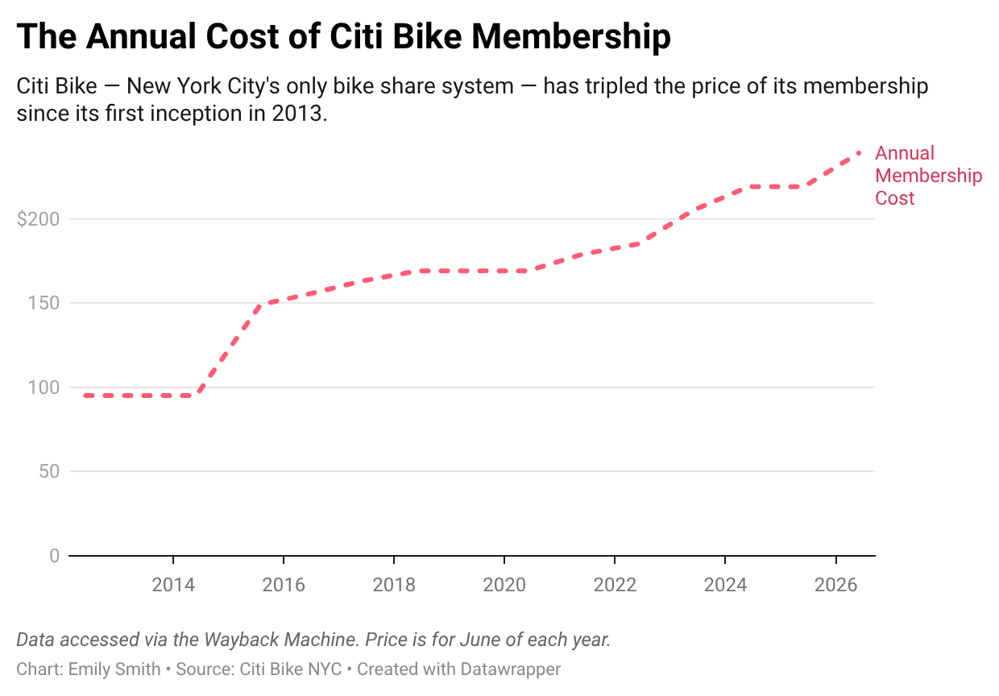

# Analysis of Citi Bike Data from 2013 to 2026

<small> This repository contains an initial cleaning, concatenating, and analysis of Citi Bike ride data, recorded during June of each year since 2013. It is being prepared in support of a story called "Citi Bike Price Increases Mean Shorter Rides." Required Google Doc on story can be found [here](https://docs.google.com/document/d/1D6aKkMMOIjaAMEQsxTA5I7Cnzosploh4IYMja0gojP8/edit?usp=sharing).

# Data

Raw data tored in <code>/data</code>.

Samples of this raw data for this assignment submission can be found in <code>/samples</code>.

This analysis includes 2 types of dataset.

The first is Citi Bike ride data, sourced from Citi Bike's own open data webpage, which can be found [here](https://s3.amazonaws.com/tripdata/index.html). Samples of this raw data can be found in <code>/samples</code>. This is most of the raw data in <code>/data</code>. For this analysis, I used the data from June of every year since 2013 (including June 2026). June is regularly one of Citi Bike's busiest months. The data was recorded in two different, but similar ways, with the company moving from one to the other in 2019. See [here](https://citibikenyc.com/system-data) for more information on Citi Bike's ride data. There are samples of each version of the raw data. The one used between 2020 and 2026 is called <code>data_2026_sample.csv</code> and the one used between 2013 and 2019 is called <code>data_2019_sample.csv</code>. The data has been cleaned so that it matches across all years, dropping and renaming some columns from each. 

The following columns were most relevant to the analysis:
+ "ended_at" and "started_at" (or "starttime" and "stoptime" for 2019 and earlier raw data): Used to calculate each ride's duration in order to find yearly averages.
+ "member_casual" (or "usertype" for 2019 and earlier raw data): Used to analyze the rate of subscription over time.
+ "rideable_type": This is the only column that I kept that is only in the post-2019 data. I used it to analyze changes in e-bike vs. regular bike usage over time.

The second is a dataset made manually using Citi Bike's pricing webpage, which can be found [here](https://citibikenyc.com/pricing), and accessing earlier versions of it using the [Wayback Machine](https://web.archive.org/). This dataset is called <code>/Citi_Bike_Prices.csv</code>.

The following columns were most relevant to the analysis:
+ "Annual Membership" and "Day Pass": Used to analyze price changes over time. 

# Methodology

The notebook <code>/Citibike_June.ipynb</code> contains the cleaning, concatenating and analysis of the data. The following analyses were conducted: 

1. Rides per year, over time. Stored in <code>/outputs</code> and called <code>/rides_per_June.csv</code>.
For this analysis I calculated how many rides were taken during June of each year of my analysis.

2. Rides taken by members vs. casual users, over time. Stored in <code>/outputs</code> and called <code>/member_percentage.csv</code>. For this analysis, I grouped the data by year and counted it based on the "member_casual" column. Then, I used this to calculate what percent of total rides are being taken by members vs. casual users for June of each year, and reduced the final dataset to only include the percent taken by members.

3. Change in duration, over time. Stored in <code>/outputs</code> and called <code>/duration_data.csv</code>. For this analysis, I calculated the average duration of rides for June of each year of my analysis. I then sorted the data by the duration in order to analyze. 

4. Change in duration, over time, e-bikes only. Stored in <code>/outputs</code> and called <code>/duration_data_ebikes.csv</code>. For this analysis, I just calculated the average duration of rides for June of each year of my analysis, but this time I grouped the values by "rideable_type" and sorted the values by year.

5. Percent of rides using e-bikes, over time. Stored in <code>/outputs</code> and called <code>/ebike_percentage.csv</code>. For this analysis, I first had to create a dataset with the number of e-bike rides taken during June for each year of my analysis. I then merged this with a dataset I already had that contains the number of total rides there were for June of each year. Then, I used this dataset to calculate the percentage of total rides that were e-bikes vs. regular bikes for June of each year, reduced to include only the e-bike percentages.

# Visualization

In order to compare this analysis to the change in Citi Bike prices, I used my raw Citi Bike price data (found in <code>/data</code> and called <code>Citi_Bike_Prices.csv</code>). I charted this data in Data Wrapper to create two visualizations.

The first is <code<Annual-Cost-Data.png</code>. It charts the price of an annual Citi Bike membership, recorded for June of each year since Citi Bike's inception in New York City. 

)

The second is <code>Overtime-Cost-Data.png</code>. It charts the additional fees that users pay per minute when using a bike for longer than 30 minutes for members, and 45 minutes for non-members. This data was only available as a per minute rate for 2020 and after, so it excludes data from 2019 and before. It is also recorded for June of each year. 

[

# Outputs

There are outputs for each analysis, as noted above. They are all stored in in <code>/data</code>.

# Running the Analysis Yourself

You can run the analysis yourself. To do so, you'll need the following installed on your computer:
+ Python 3

# Licensing 

All code in this repository is available under the [MIT License](https://opensource.org/license/MIT). The data file in the output/ directory is available under the [Creative Commons Attribution 4.0 International (CC BY 4.0)](https://creativecommons.org/licenses/by/4.0/) license. All files in the data/ directory are released into the public domain.

# Feedback / Questions?
Contact Emily Smith at emily.smith15@journalism.cuny.edu.
